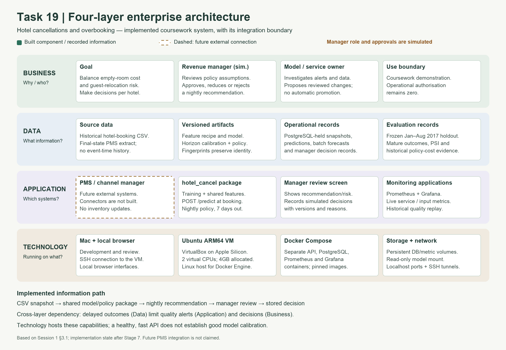

# Diary 1 — four-layer enterprise architecture

Prepared 8 November 2026. Scope: implemented coursework system through Stage 7, plus the explicitly marked future hotel-system boundary. This completes the architecture-map item, not the alternative-pattern comparison or AI Act classification.

Use the PNG in the written diary and slides; the SVG is editable and scales without loss of quality. A Mermaid source provides the same domain mapping with explicit information-flow links, while the exported figure uses a simpler four-row layout.

- [High-resolution PNG](figures/diary1-four-layer-architecture.png)
- [Editable SVG](figures/diary1-four-layer-architecture.svg)
- [Mermaid source](figures/diary1-four-layer-architecture.mmd)

## Layer mapping

The course's Session 1 main document, section 3.1, page 5, names Business, Data, Application and Technology. It describes these as TOGAF architecture domains. The mapping follows that course order.

| Layer | Question | Our project | Who acts or owns the responsibility? |
|---|---|---|---|
| Business | Why, and who? | Balance empty-room and guest-relocation costs separately for City and Resort; review costs, risks and candidate nightly quantities; retain human control | The student acts as simulated revenue manager and project/model owner. No real hotel approval or deployment is claimed. |
| Data | What information? | Historical hotel-booking CSV; snapshot definitions and date/feature-availability assumptions; frozen 2017 holdout; model/calibration/policy versions; prediction, batch and decision records; mature-outcome and drift/cost evidence | Project/model owner maintains definitions, quality checks, provenance and model versions. A real PMS/data owner would need to confirm event-time semantics and capacity. |
| Application | Which systems? | `hotel_cancel` training/feature/model/policy package; booking API; nightly batch; manager-review application; Prometheus metric/alert processing and Grafana dashboard | Simulated manager uses the review screen. Model/service owner inspects dashboard and alerts. External PMS and channel-manager connectors remain planned. |
| Technology | Running on what? | Mac development/browser access; SSH; VirtualBox Ubuntu ARM64 VM with two virtual CPUs and 4GB allocated RAM; Docker Engine/Compose; API, PostgreSQL, Prometheus and Grafana containers; persistent volumes and read-only model mount | The student operates the coursework deployment and its private local environment. This is not a production operations team. |

## Why components appear in more than one layer

The layers describe different concerns, not four folders or four containers. **Database records belong to Data**, whereas the **PostgreSQL engine/container and volume belong to Technology**. Similarly, Grafana's role in presenting monitoring belongs to Application, while the container that hosts it belongs to Technology. The Python package is application logic; Docker packages its execution environment.

## Implemented information paths

1. **Booking prediction:** a valid booking object enters `POST /predict`; the shared feature recipe and frozen model produce a booking-to-arrival probability. PostgreSQL and structured logs retain the prediction ID, model version and limited input summary.
2. **Nightly decision:** a dataset-derived historical snapshot is scored with saved horizon calibration and reference policy settings. The manager-review screen displays candidate rooms, risks and costs. A simulated reviewer can approve, reduce or reject a quantity with a reason; the database stores a final versioned record. Real operational authorisation remains zero.
3. **Monitoring:** the API exposes service/input metrics to Prometheus; Grafana presents them. A separate labelled historical replay supplies mature-week calibration, PSI and frozen policy-cost evidence. The model owner investigates alerts; an alert does not automatically retrain or promote a model.

The nightly example still uses the reproduced reference baseline. It does not silently promote the unsigned Stage 5 sensitivity candidates. Policy-wide sign-off in ADR 0005 remains distinct from a simulated nightly review.

## Enterprise boundary and cross-layer reasoning

The notebook describes a future position between a hotel PMS, the channel manager and a revenue manager. In our current demonstration, the CSV stands in for a PMS extract. There is **no live PMS connector, no channel-manager inventory update and no guest messaging**. The dashed application box and Mermaid links identify that future integration; they must not be described as implemented.

A concrete cross-layer dependency is **label delay**: arrival and settlement timing in the Data layer limits when Application-layer monitoring can assess cancellation calibration. The Business-layer manager therefore cannot infer trustworthy predictions from a fast, healthy service. Technology availability and response speed are necessary operational properties, not proof of predictive quality. The final-state dataset and the additional stay/status-date discrepancy also limit claims about actual occupancy.

Security and governance cut across the layers. The local SSH boundary, private configuration and limited logs support the coursework deployment. Reviewer names are self-declared and decisions are explicitly simulated; a real system would need authenticated roles, verified PMS/capacity data and a policy approval process. No legal risk classification is asserted in this diagram; that is a separate diary investigation.

## Evidence and scope

- [Stage 6 service and snapshot report](stage6-operational-service.md): implemented package, API, batch, container and PostgreSQL path.
- [Manager approval workflow](manager-approval.md): simulated reviewer responsibility and immutable final records.
- [Stage 7 monitoring report](stage7-monitoring.md): running four-container stack, dashboard, latency evidence and alert/retraining boundaries.
- [Additional data quirk](diary1-additional-quirk.md): limits of treating recorded stay length as realised occupancy.

The source Session 1 PDF is supplied course material: `ARI3217 - Main Document - Session 1_ The AI Readiness Crisis.pdf`, section 3.1, page 5. Keep the figure and this explanation in the same commit; they describe architecture, not an additional experiment or new measured result. Reuse the diagram as evidence, then express the diary's reasoning in your own words.
