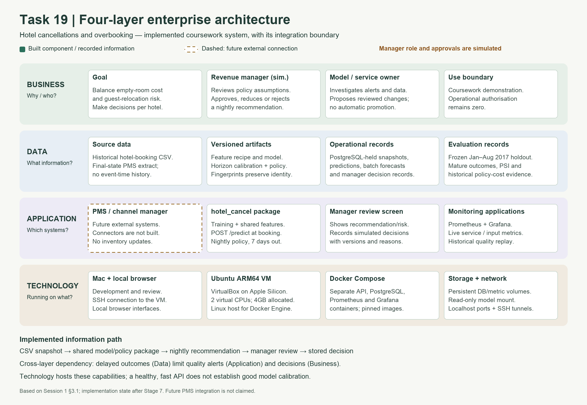
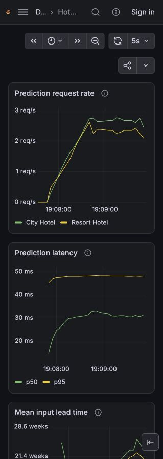

# Reflective Diary - Entry 1

Luke Camilleri | ARI3217 | Task 19 | 8 November 2026

Draft for student review. 503 words (excluding citations, tables, figures and references).

I repackaged the supplied LightGBM baseline without changing its method, using configuration, shared preprocessing, tests and a thin notebook. On the January-August 2017 holdout, AUPRC was 0.786 for City and 0.628 for Resort. The booking pipeline took 1.80 seconds, including loading, feature construction, training and scoring; this is not an isolated fit-time measurement. A separate fresh clone reproduced the baseline with pinned dependencies. [E1-E2]

Data inspection showed why reproducing scores is insufficient. There were 31,994 extra exact duplicate rows, 1,959 zero-ADR records and a large nationality imbalance between cancelled and arrived offline bookings (Table 2). These findings challenge random splits, naive revenue calculations and nationality-based explanations. My additional check found 27 Check-Out records whose status date disagreed with arrival plus recorded nights. This does not prove corruption: the source permits nights stayed or booked-to-stay. I added an automated audit rather than silently relabelling or deleting them. [E3; R1]

The Docker test challenged my assumption that passing local tests meant the project was portable. The container initially lacked PyArrow, which the saved model needed when loading pandas metadata. Testing in Ubuntu exposed a dependency that the Mac environment had concealed. The corrected image matched host batch predictions within the recorded tolerance. [E2]

The most significant finding was that technical success did not establish predictive reliability. Both load phases returned all 600 measured requests successfully, with API p95 below 35 ms, yet the Resort model failed its calibration check: its expected/observed cancellation ratio was 0.68 against the 0.85-1.15 band. I learnt to distinguish service monitoring from model monitoring: a healthy dashboard cannot immediately establish prediction quality when outcomes arrive later. The quality evidence here is historical replay, not live hotel outcomes. [E2]

I was initially confused about manager approval: did it mean signing a document or approving recommendations inside the system? This helped me distinguish approval of the overall policy from approval of a particular night's quantity. We implemented a simulated nightly review that records the reviewer, quantity and reason, while recognising that it does not replace policy-wide sign-off or authorise real hotel operations. [E4]

Mapping business, data, application and technology clarified these responsibilities (Figure 1). I would retain human approval because capacity is unknown and calibration remains imperfect, although human review itself does not guarantee better decisions. Automatic acceptance could remove review delay, but its end-to-end latency and running cost are unmeasured. With illustrative review labour of EUR2.50/day, one extra EUR250 relocation every 100 days would erase that saving. I would reconsider automation after verifying capacity, independently evaluating policy outcomes and measuring review delays and costs. [E5-E6]

My working AI Act assessment for ordinary commercial overbooking advice is non-high-risk under Article 6 and Annex III. The provider would be the entity supplying it under its name; the hotel operator would be the deployer. The local coursework test requires a separate Article 2(8) scope assessment. A changed intended use would require reassessment. [E7; R2-R5]

I used Codex to assist with implementation, tests, data investigation, diagrams and drafting. This assistance makes it especially important that I can explain the results and justify the decisions myself.

---

## Supporting evidence (excluded from word count)

### Table 1. Reproduction, quality and service measurements

| Measure | Result and boundary | Evidence |
| --- | --- | --- |
| Baseline holdout | 40,687 bookings; Jan-Aug 2017. City AUPRC 0.785722; Resort 0.627908. | E1-E2 |
| Calibration diagnostic | Expected/observed: City 0.911281 PASS; Resort 0.681723 FAIL. Reference band 0.85-1.15. | E2 |
| Booking pipeline | 1.798645 seconds, including loading, features, fit and scoring; 20/20 reference comparisons passed. | E2 |
| Fresh clone | Separate pinned environment; 16 tests, 20 baseline comparisons and thin notebook passed. Code tested: 39fb510. | E1 |
| Load: booking phase | 300 measured requests; 8 workers; offered 5 requests/s for 60 s. p50 29.59 ms; p95 34.25 ms; p99 36.13 ms; 0 errors. | E2 |
| Load: shifted phase | 300 measured requests; same load; synthetic lead-time shift. p50 29.36 ms; p95 33.62 ms; p99 36.80 ms; 0 errors. | E2 |
| Load interpretation | 20 warmups excluded in total. Client timing includes scheduled-arrival queueing. All 600 measured prediction IDs persisted. Target p95 <250 ms; not a maximum-capacity test. | E2 |
| Batch example | 81 bookings, 44.72 ms including model loading/inference; excludes full database, PMS and human workflow. | E2 |
| Container and parity | 212,353,366 bytes (212.35 MB); stop 0.187 s, exit 0. Host/container batch match: absolute and relative tolerances 1e-12. | E2 |
| Linux verification | 118 tests, no failures/errors/skips; dashboard 8 panels; 6 healthy alert-rule evaluations. External alert delivery is not configured. | E2 |

### Table 2. Data quirks

| Observation | Count / implication |
| --- | --- |
| Extra exact duplicate rows | 31,994 / 119,390 rows; random-split overlap can inflate evaluation. |
| Zero ADR | 1,959 rows; zero quoted price must not silently become ordinary room revenue. |
| Nationality/channel artefact | Within Offline TA/TO: PRT accounts for 8,121/8,311 cancellations (97.71%) and 3,864/15,908 arrivals (24.29%). These are nationality shares, not cancellation rates; causation is unproven. |
| Additional: Check-Out date mismatch | 27 / 75,166 Check-Out rows (21 Resort, 6 City; 24 distinct rows). Status date differs from arrival plus recorded nights. Counted by a tested audit; interpretation remains uncertain. |

### Figure 1. Four enterprise-architecture layers

### Table 3. Capability comparison

| Criterion | Implemented: human review | Hypothetical: automatic acceptance |
| --- | --- | --- |
| Latency budget | Measured API p95 34.25ms; example batch 44.72ms; human turnaround unmeasured | Common calculation reused in proposal; human wait removed; connector/end-to-end latency unmeasured |
| Running cost/day | Shared platform unmeasured + assumed EUR2.50/day review labour + oversight and policy losses | Shared platform unmeasured; potentially saves assumed EUR2.50/day review labour; added control/integration/incident costs unknown |
| Decision owner | Simulated manager records approve/reduce/reject; project owner maintains model/service | System would execute an authorised policy; business owner remains accountable; not implemented |
| Failure behaviour | No approval means no approved quantity; database/review failure blocks a new decision; operational fallback zero/manual | Would require fail-closed capacity/quality/version/connector checks; these automatic controls are not built |

Cost assumption: two hotels x 5 minutes/day x EUR15/hour = EUR2.50/day. Illustrative labour, not measured total cost.

### Figure 2. Monitoring preview

### Evidence register

**E1** e3605b4 - docs/fresh-clone-verification.md and docs/evidence/fresh-clone/. Fresh-clone code: 39fb510.

**E2** 6ccc11e - docs/stage7-monitoring.md; docs/evidence/stage7/{baseline-regression,performance,batch,container,tests-linux,verification}.json. Screenshot: artifacts/stage7/dashboard-preview.jpg (generated, not version-controlled).

**E3** e57de9a - docs/diary1-additional-quirk.md; docs/evidence/diary1/additional-quirk.json; docs/evidence/data-quirks.json; tests/test_stay_audit.py.

**E4** bb8d11d - docs/manager-approval.md and simulated approval implementation. Policy-wide sign-off remains separate.

**E5** 1b5cbc9 - docs/diary1-architecture.md; docs/figures/diary1-four-layer-architecture.png.

**E6** dec3510 - docs/diary1-pattern-comparison.md; docs/evidence/diary1/pattern-comparison*.csv and pattern-cost-sensitivity.csv.

**E7** e705484 - docs/diary1-ai-act-classification.md; docs/evidence/diary1/ai-act-classification.json. Scoped working assessment, reviewed 8 November 2026.

### Primary references

**R1** [Antonio, de Almeida & Nunes (2019), Hotel booking demand datasets. Data in Brief 22, 41-49.](https://pmc.ncbi.nlm.nih.gov/articles/PMC6297060/)

**R2** [European Commission AI Act Explorer: Article 6 - high-risk classification.](https://ai-act-service-desk.ec.europa.eu/en/ai-act/article-6)

**R3** [European Commission AI Act Explorer: Annex III - listed uses.](https://ai-act-service-desk.ec.europa.eu/en/ai-act/annex-3)

**R4** [European Commission AI Act Explorer: Article 3 - provider/deployer definitions.](https://ai-act-service-desk.ec.europa.eu/en/ai-act/article-3)

**R5** [European Commission AI Act Explorer: Article 2(8) - pre-deployment testing scope.](https://ai-act-service-desk.ec.europa.eu/en/ai-act/article-2)

Course framing: ARI3217 Reflective diary brief; Session 1 sections 3.1 and 3.3. Slides and own-voice video remain separate deliverables.
