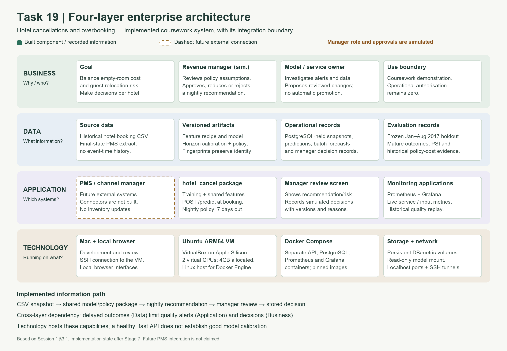
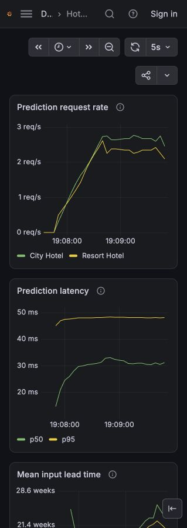

# Reflective Diary - Entry 1

Luke Camilleri | ARI3217 | Task 19 | 18 November 2026

Draft for student review. 525 words (excluding citations, tables, figures and references).

I repackaged the supplied LightGBM baseline without changing its method, using configuration, shared preprocessing, tests and a thin notebook. On the January-August 2017 holdout, AUPRC was 0.786 for City and 0.628 for Resort. A new isolated fit took 0.521 seconds; the corresponding loading-to-scoring pipeline took 1.696 seconds. These local measurements are separate from the historical Ubuntu run. A separate fresh clone reproduced the baseline with pinned dependencies. [E1-E2]

Data inspection showed why reproducing scores is insufficient. There were 31,994 extra exact duplicate rows, 1,959 zero-ADR records and a large nationality imbalance between cancelled and arrived offline bookings (Table 2). These findings challenge random splits, naive revenue calculations and nationality-based explanations. My additional check found 27 Check-Out records whose status date disagreed with arrival plus recorded nights. This does not prove corruption: the source permits nights stayed or booked-to-stay. I added an automated audit rather than silently relabelling or deleting them. [E3; R1]

The Docker test challenged my assumption that passing local tests meant the project was portable. The container initially lacked PyArrow, which the saved model needed when loading pandas metadata. Testing in Ubuntu exposed a dependency that the Mac environment had concealed. The corrected image matched host batch predictions within the recorded tolerance. [E2]

The most significant finding was that technical success did not establish predictive reliability. Across both load phases, all 600 measured requests succeeded, with API p95 below 35 ms, yet the Resort model failed its calibration check: its expected/observed cancellation ratio was 0.68 against the 0.85-1.15 band. I learnt to distinguish service monitoring from model monitoring: a healthy dashboard cannot immediately establish prediction quality when outcomes arrive later. The quality evidence here is historical replay, not live hotel outcomes. [E2]

I was initially confused about manager approval: did it mean signing a document or approving recommendations inside the system? This helped me distinguish approval of the overall policy from approval of a particular night's quantity. We implemented a simulated nightly review that records the reviewer, quantity and reason, while recognising that it does not replace policy-wide sign-off or authorise real hotel operations. [E4]

Mapping the four architecture layers clarified ownership (Figure 1). I compared online booking scores with daily batch scoring of the same 325 records: online p95 was 22.48 ms and batch completion 0.013 seconds, including artifact loading. Batch adds up to a day of waiting. At an assumed EUR0.10 per allocated hour, dedicated online hosting costs EUR2.40/day versus EUR0.0017 for a one-minute-billed batch; a shared running host saves no invoice cost. I retain online responses where required, with human-approved nightly policy decisions. I would switch booking scores to batch if the owner accepts daily delay and separately billed compute yields savings. [E5; E8]

My working AI Act assessment for ordinary commercial overbooking advice is non-high-risk under Article 6 and Annex III. The provider would be the entity supplying it under its name; the hotel operator would be the deployer. The local coursework test requires a separate Article 2(8) scope assessment. A changed intended use would require reassessment. [E7; R2-R5]

I used Codex to assist with implementation, tests, data investigation, diagrams and drafting. This assistance makes it especially important that I can explain the results and justify the decisions myself.

---

## Supporting evidence (excluded from word count)

### Table 1. Reproduction, quality and service measurements

| Measure | Result and boundary | Evidence |
| --- | --- | --- |
| Baseline holdout | 40,687 bookings; Jan-Aug 2017. City AUPRC 0.785722; Resort 0.627908. | E1-E2 |
| Calibration diagnostic | Expected/observed: City 0.911281 PASS; Resort 0.681723 FAIL. Reference band 0.85-1.15. | E2 |
| New isolated fit | 0.520928 seconds around the unchanged fit function; excludes loading/features/scoring. New local measurement. | E8 |
| New booking pipeline | 1.696460 seconds for the corresponding fresh raw loading-to-scoring run. | E8 |
| Historical booking pipeline | 1.798645 seconds, including loading, features, fit and scoring; 20/20 reference comparisons passed. | E2 |
| Fresh clone | Separate pinned environment; 16 tests, 20 baseline comparisons and thin notebook passed. Code tested: 39fb510. | E1 |
| Load: booking phase | 300 measured requests; 8 workers; offered 5 requests/s for 60 s. p50 29.59 ms; p95 34.25 ms; p99 36.13 ms; 0 errors. | E2 |
| Load: shifted phase | 300 measured requests; same load; synthetic lead-time shift. p50 29.36 ms; p95 33.62 ms; p99 36.80 ms; 0 errors. | E2 |
| Load interpretation | 20 warmups excluded in total. Client timing includes scheduled-arrival queueing. All 600 measured prediction IDs persisted. Target p95 <250 ms; not a maximum-capacity test. | E2 |
| Batch example | 81 bookings, 44.72 ms including model loading/inference; excludes full database, PMS and human workflow. | E2 |
| Container and parity | 212,353,366 bytes (212.35 MB); stop 0.187 s, exit 0. Host/container batch match: absolute and relative tolerances 1e-12. | E2 |
| Linux verification | 118 tests, no failures/errors/skips; dashboard 8 panels; 6 healthy alert-rule evaluations. External alert delivery is not configured. | E2 |

### Table 2. Data checks and guarding tests

| What the card says | What I found | Consequence | Guard or check |
| --- | --- | --- | --- |
| Exact duplicate group rows can leak through random splits | 31,994 extra duplicates / 119,390 rows | Inflated evaluation if twins cross train/test | `guard_temporal_splits`; `tests/test_splits.py::test_bad_partitions_fail`; duplicate-overlap test in `test_audit.py` |
| ADR contains zero and extreme values | 1,959 zero ADR rows | Zero values need explicit treatment; a global mean misprices nights | `validate_raw` counts anomalies without deleting them; `test_known_anomalies_are_counted_not_silently_removed`; `test_nightly_median_is_not_global_mean_and_negative_value_is_floored` |
| Nationality appears completed after booking | PRT is 8,121/8,311 offline cancellations (97.71%) and 3,864/15,908 arrivals (24.29%) | Unavailable/sensitive recording artefact can inflate predictions | Country excluded; `test_each_forbidden_input_cannot_change_any_feature_even_under_an_alias` fails on feature dependence |
| Additional check, not a listed card quirk | 27/75,166 Check-Out date mismatches, 24 distinct rows | Planned versus actual nights are uncertain; retain rows and labels | `checkout_date_checks` flags cases; `test_same_day_checkout_positive_stay_is_flagged_without_changing_label` guards detection and non-mutation |

### Figure 1. Four enterprise-architecture layers

### Table 3. Online versus daily batch booking scores

Both alternatives produce the same booking-to-arrival probabilities. The seven-day overbooking policy and human approval remain separate.

| Criterion | Online booking prediction | Daily batch booking prediction |
| --- | --- | --- |
| Latency budget | Existing 250 ms response budget; new loopback p95 22.48 ms on 325 requests at 5/s | 0.013 s median to load and score the same 325 records over five repeats; up to 24 hours scheduling wait, requiring an owner-approved deadline |
| Running cost/day | Dedicated 24-hour allocation: EUR2.40 at assumed EUR0.10/hour; measured CPU 4.978 s for this workload | One-minute-minimum on-demand scenario: EUR0.0017/day at the same assumed rate; measured CPU 0.013 s. Shared always-running host gives EUR0 invoice saving |
| Decision owner | Model/service owner maintains score path; revenue manager still approves nightly oversell | Same accountable owners; batch scheduler publishes scores, never authorises oversell |
| Failure behaviour | Invalid/unavailable request fails visibly; standalone logging is best effort; no approved quantity follows from a score | Failed/missing job leaves scores unavailable or stale; prospective consumer must reject stale versions; no automated approval |

Measured fit, online and batch values: E8. Batch and HTTP predictions match within 1e-12. New local tests exclude PostgreSQL, external networks, live PMS and human review; historical Ubuntu p95 remains 34.25 ms with database logging. Observed reconstructed 2016 entries/day: mean 160.0, p95 324.5, maximum 818. The selected actual day has 325 entries. Compressing it to 5/s is a stress envelope, not observed interarrival timing. Pricing, billing minimum and dedicated/on-demand hosting are explicit assumptions, not measured bills; labour, energy and ownership costs are unmeasured. Switching requires both an acceptable daily deadline and actual avoidable costs.

### Classification line

Working assessment: ordinary commercial advice, other/non-high-risk under Article 6 and Annex III; prospective provider = the entity releasing the system under its own name (Luke if released as his product); prospective deployer = hotel operator. Coursework testing scope remains separately assessed under Article 2(8), as in ADR 0009. This is the existing scoped project assessment, not a new legal opinion.

### Figure 2. Monitoring preview

### Evidence register

**E1** e3605b4 - docs/fresh-clone-verification.md and docs/evidence/fresh-clone/. Fresh-clone code: 39fb510.

**E2** 6ccc11e - docs/stage7-monitoring.md; docs/evidence/stage7/{baseline-regression,performance,batch,container,tests-linux,verification}.json. Screenshot: artifacts/stage7/dashboard-preview.jpg (generated, not version-controlled).

**E3** e57de9a - docs/diary1-additional-quirk.md; docs/evidence/diary1/additional-quirk.json; docs/evidence/data-quirks.json; tests/test_stay_audit.py.

**E4** bb8d11d - docs/manager-approval.md and simulated approval implementation. Policy-wide sign-off remains separate.

**E5** 1b5cbc9 - docs/diary1-architecture.md; docs/figures/diary1-four-layer-architecture.png.

**E6** dec3510 - historical illustrative human/automation comparison and cost sensitivity, retained in Git history. The current online/batch comparison uses E8 instead; its costs are explicit billing scenarios.

**E8** New 18 November local measurement: `docs/evidence/diary1/review-measurements.json`; script `scripts/measure_diary1.py`. Base commit and script hash are recorded; include the measurement script and report in the final reviewed commit. No serving artifact was replaced. Cost figures are scenarios.

**E7** e705484 - docs/diary1-ai-act-classification.md; docs/evidence/diary1/ai-act-classification.json. Scoped working assessment, reviewed 8 November 2026.

### Primary references

**R1** [Antonio, de Almeida & Nunes (2019), Hotel booking demand datasets. Data in Brief 22, 41-49.](https://pmc.ncbi.nlm.nih.gov/articles/PMC6297060/)

**R2** [European Commission AI Act Explorer: Article 6 - high-risk classification.](https://ai-act-service-desk.ec.europa.eu/en/ai-act/article-6)

**R3** [European Commission AI Act Explorer: Annex III - listed uses.](https://ai-act-service-desk.ec.europa.eu/en/ai-act/annex-3)

**R4** [European Commission AI Act Explorer: Article 3 - provider/deployer definitions.](https://ai-act-service-desk.ec.europa.eu/en/ai-act/article-3)

**R5** [European Commission AI Act Explorer: Article 2(8) - pre-deployment testing scope.](https://ai-act-service-desk.ec.europa.eu/en/ai-act/article-2)

Course framing: ARI3217 Reflective diary brief; Session 1 sections 3.1 and 3.3. Slides and own-voice video remain separate deliverables.
