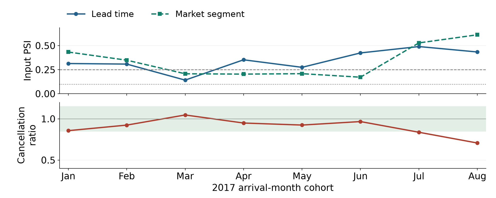
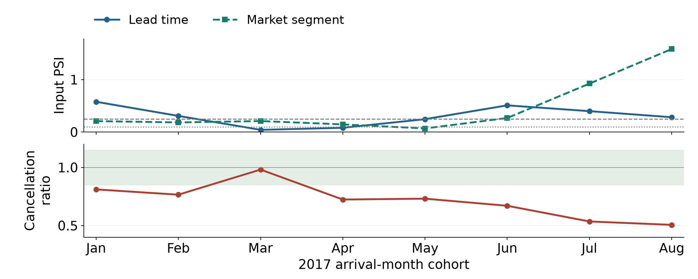

# Reflective Diary Entry 2

Luke Camilleri | ARI3217 | Task 19 | 15 November 2026

**Draft for student review.** Main reflection: 500 words, excluding citations, tables, figures and references. Peer feedback and card revisions are recorded. Reciprocal exchange details and a passing strict model-gate CI example remain open.

For Entry 2, I investigated whether my evaluation and release controls told the same story. I retained the supplied LightGBM learner and the frozen January-August 2017 holdout. I compared a stratified random split with the prescribed forward split, then examined calibration and input drift. I kept this diagnostic random experiment out of deployment. [E1]

Random splitting produced City AUPRC of 0.879 and Resort AUPRC of 0.748, compared with 0.786 and 0.628 forward in time. The reductions were 9.3 and 12.0 percentage points. There were 4,626 full-row signatures shared across random training and test, versus none across the prescribed forward training and holdout. Random training included future-era bookings. These findings ruled out random evaluation for release, although different time mixtures and test sizes prevent attributing the entire gap to duplicates. [E1]

Metric choice changed the conclusion. Both hotels passed their AUPRC floors, yet Resort predicted only 0.682 cancellations per observed cancellation. I retained the expected/observed band of 0.85-1.15 as the calibration guard, alongside AUPRC and ECE checks. AUPRC alone would have admitted this underestimation. Accuracy also concealed the issue: Resort achieved 0.735 against a majority-class baseline of 0.692. Its ranking was useful, but that did not establish reliable cancellation totals for an economic decision. [E1-E2]

I used 1,000 arrival-date cluster bootstrap samples because independent booking-row resampling would ignore same-day dependence. Resort's ratio interval was 0.644-0.719, entirely below the accepted band. Its AUPRC interval, 0.584-0.665, remained above the 0.308 prevalence baseline. This strengthened my decision to preserve the failure rather than relax a threshold or use the separate improved calibrator to make the given model pass. The intervals omit dependence between dates and cannot guarantee future performance. [E2]

The CI evidence taught me to separate reproducibility from release approval. One recorded GitHub run failed under the strict gate; a later run passed coursework verification while preserving the same Resort failure. That later green run does not demonstrate a passing strict model gate. I need to retain this distinction in the hand-in rather than present the checks as interchangeable. [E3]

Monitoring exposed another limitation. City lead-time PSI was 0.424 in June and 0.434 in August, but its calibration ratio moved from 0.967 to 0.707. Resort's April PSI was only 0.082 while its ratio was already 0.724. Lead-time drift alone would therefore miss harmful calibration changes or trigger investigation during acceptable calibration. I propose PSI above 0.10 for investigation and 0.25 for action review, with two consecutive mature monthly ratio breaches triggering a retraining review. These are provisional controls, not automatic model replacement. [E2]

Three runs supported City rollback from version 2 to 1 and back. Identical predictions confirmed reproducibility. Only the coursework owner may move its alias. [E4]

Feedback attributed to Jake Desira identified managers as the least well served readers. I added a City version 2 summary with results and permitted use, plus monitoring responsibilities and failed-rollback fallbacks. This taught me that evidence must be accessible to its reader. The review date and reciprocal exchange remain unconfirmed. Codex assisted implementation, analysis and drafting. I remain responsible for the interpretation. [E5]

## Table 1 Split comparison

| Hotel | Split | Test n | AUPRC | Ratio | Accuracy |
|---|---|---:|---:|---:|---:|
| City Hotel | random | 23,737 | 0.878872 | 1.001271 | 0.804019 |
| Resort Hotel | random | 12,080 | 0.748214 | 0.997037 | 0.810762 |
| City Hotel | forward | 27,508 | 0.785722 | 0.911281 | 0.721426 |
| Resort Hotel | forward | 13,179 | 0.627908 | 0.681723 | 0.735033 |

## Table 2 Forward bootstrap evidence

| Hotel | Metric | 95% interval |
|---|---|---|
| City Hotel | auprc | 0.752263-0.813284 |
| City Hotel | expected_observed_ratio | 0.892527-0.931058 |
| City Hotel | brier | 0.165289-0.180044 |
| City Hotel | prevalence_baseline_auprc | 0.405058-0.444798 |
| Resort Hotel | auprc | 0.584275-0.664567 |
| Resort Hotel | expected_observed_ratio | 0.644469-0.718879 |
| Resort Hotel | brier | 0.167367-0.187902 |
| Resort Hotel | prevalence_baseline_auprc | 0.289613-0.324863 |

## Figures

Figure captions: final recorded outcomes grouped by 2017 arrival month; retrospective replay, not observed live alerts. PSI uses the unchanged training period as reference. Green band is the existing 0.85-1.15 ratio gate.

## Evidence register and methods

| Item | Source or limitation |
|---|---|
| E1 Random and forward investigation | Random run 4ce11065ed9d4dc3aac3054150498ef9; Forward run d0baccc80c604310922bd706d6f9f87b |
| E2 Intervals and monthly replay | Run 574ffcbae4774ceda7d4e677216e5d20; 1,000 arrival-date clusters; conditional historical intervals |
| E3 Failing and passing CI | Failure 43022126664; coursework pass 43025312530; Passing strict model-gate CI: NOT YET DEMONSTRATED |
| E5 Peer feedback and revisions | docs/reviews/session6-model-card-peer-review.md; docs/model-cards/task19-session6-city-booking-v2.md; docs/evidence/diary2/model-card-review-update.json. |
| E4 Clean training and City rollback | Commit c9e3bfaf6b3d073dd9930ba60761ef932af1ab80; Rollback run 932502d0320248d2abe62ebc9b7323cf |
| Frozen window | Arrivals from 2017-01-01 inclusive to 2017-09-01 exclusive. |
| Frozen feature/label fingerprint | ac37475750f8f24abb767a78f7775b905a6ce0dce90d364402074181a9db017b |
| Split design | Random: 70/30 stratified by label, seed 3217, on normalized arrival/hotel-sorted rows. Forward training: July 2015-June 2016. Agent vocabulary is learned separately from each training subset. The random split includes future-era training observations and is quarantined. |
| Duplicate count | 4,626 shared normalized full-row signatures overall, not per hotel. The earlier 4,743 raw-order audit used a different row order. Random seed alone does not fix a split when ordering changes. |
| Baseline | A constant training cancellation-rate predictor. AUPRC equals each test cohort's cancellation prevalence. Majority prediction uses the training majority class. |
| Bootstrap | 1,000 percentile replicates; 243 arrival dates resampled within each hotel; retain all rows from sampled dates. Does not preserve dependence across dates or establish future coverage. |
| Monitoring | Final recorded outcomes, not event-time reconstruction. Monthly cohorts are not live alert timestamps. Provisional review triggers; do not optimise threshold values against these eight months. |
| Reproducibility | Model source c9e3bfaf6b3d073dd9930ba60761ef932af1ab80. New analysis script is archived in its MLflow runs and still needs committing with the diary. See investigation.json for working-tree state. |
| Registered model | models:/task19-session6-city-booking/2 in artifacts/diary2/mlflow.db. Version card attached. Local UI can inspect it after starting the documented tracking server. |
| Scope of clean training | Three repeated prescribed baseline training pipelines. They also record a separate Resort calibration extension, excluded from the given-model gate comparison in this entry. No improved Resort champion is used to turn its reference gate green. |
| Peer review | Feedback supplied by Luke on 15 November 2026 and attributed to Jake Desira. Manager identified as least well served reader. City version 2 card revised with a standalone summary, responsibilities, monitoring rules and rollback fallbacks. Actual review date, exact reviewed version and reciprocal exchange remain unconfirmed. See docs/reviews/session6-model-card-peer-review.md. |
| AI use | OpenAI Codex assisted code, analysis, plots and drafting. Luke must confirm that the reflection represents his own reasoning. |

### Links

- Failing CI: https://github.com/Lukecamill/hotel-cancellations/actions/runs/43022126664
- Coursework-pass CI: https://github.com/Lukecamill/hotel-cancellations/actions/runs/43025312530
- Source commit: https://github.com/Lukecamill/hotel-cancellations/commit/c9e3bfaf6b3d073dd9930ba60761ef932af1ab80
- Source brief: ARI3217 Reflective diary - Entry 2, supplied by the student.
- Reproduce with `PYTHONPATH=src .venv-tracking/bin/python scripts/diary2_investigation.py`. Do not refreeze the holdout.
